<!-- ═══════════════════════════════════════════════════════════════════════ -->
<!--                    ◈ SOVEREIGN SEAL HEADER ◈                          -->
<!-- ═══════════════════════════════════════════════════════════════════════ -->

  

<!-- ═══════════ STATUS BADGES ═══════════ -->

&nbsp;&nbsp;

&nbsp;&nbsp;

  

 

  

 

<!-- ═══════════════════════════════════════════════════════════════════════ -->
<!--                            ◈ ABOUT ◈                                  -->
<!-- ═══════════════════════════════════════════════════════════════════════ -->

  

 

<table>
<tr>

<td width="50%" align="center">
 

  

 

 

  
</td>

<td width="50%" align="center">
 

  

 

 

  
</td>

</tr>
<tr>
<td colspan="2" align="center">
 

&nbsp;&nbsp;

  
</td>
</tr>
</table>

 

  
    Full-Stack Developer with hands-on experience across web and desktop technologies, delivering management systems 
    from backend APIs to deployed desktop applications for real operational environments.
  

 

  

 

<!-- ═══════════════════════════════════════════════════════════════════════ -->
<!--                         ◈ EXPERIENCE ◈                                -->
<!-- ═══════════════════════════════════════════════════════════════════════ -->

  

 

  
  
  
  

 

  

 

  

 

<!-- ═══════════════════════════════════════════════════════════════════════ -->
<!--                       ◈ SELECTED PROJECTS ◈                           -->
<!-- ═══════════════════════════════════════════════════════════════════════ -->

  

 

<table>
<tr>

<td width="33%" align="center" valign="top">
 

 
<b>Enterprise Solution</b>
  
Trouble reporting system for a WAPDA facility: report tracking, status updates and admin controls.
  

  
</td>

<td width="33%" align="center" valign="top">
 

 
<b>E-Commerce Platform</b>
  
Responsive e-commerce platform for clothing brands with smooth product browsing and streamlined checkout.
  

  
</td>

<td width="33%" align="center" valign="top">
 

 
<b>Business Management System</b>
  
Platform for tracking data, records and user access, with reporting, analytics and multi-user access control.
  

  
</td>

</tr>
</table>

 

  

 

<!-- ═══════════════════════════════════════════════════════════════════════ -->
<!--                         ◈ TECH ARSENAL ◈                              -->
<!-- ═══════════════════════════════════════════════════════════════════════ -->

  

 

<table>
<tr>
<td align="center">
 

  

  

  
</td>
</tr>
</table>

 

<table>
<tr>
<td align="center">
 

  

  

  
</td>
</tr>
</table>

 

<table>
<tr>
<td align="center">
 

  

  

  
</td>
</tr>
</table>

 

<table>
<tr>
<td align="center">
 

  

  
</td>
</tr>
</table>

 

<table>
<tr>
<td align="center">
 

  

  
</td>
</tr>
</table>

 

  

 

<!-- ═══════════════════════════════════════════════════════════════════════ -->
<!--                       ◈ GITHUB ANALYTICS ◈                            -->
<!-- ═══════════════════════════════════════════════════════════════════════ -->

  

 

  

 

  

 

<!-- ═══════════════════════════════════════════════════════════════════════ -->
<!--                        ◈ LET'S CONNECT ◈                             -->
<!-- ═══════════════════════════════════════════════════════════════════════ -->

  

 

  
  &nbsp;&nbsp;
  
  &nbsp;&nbsp;
  

  

<!-- ═══════════════════════════════════════════════════════════════════════ -->
<!--                         ◈ PREMIUM FOOTER ◈                           -->
<!-- ═══════════════════════════════════════════════════════════════════════ -->

 

  

◈ If my work adds value to yours, a ⭐ speaks volumes ◈

 

Crafted with precision by <a href="https://github.com/ShoaibAli7869"><b>Shoaib Ali</b></a>

  

